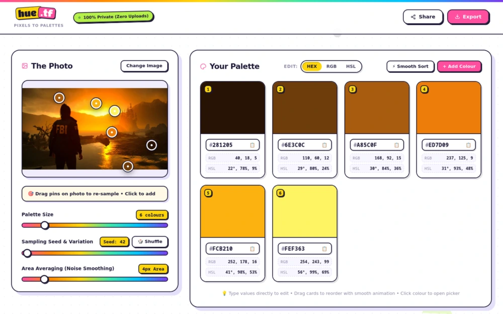
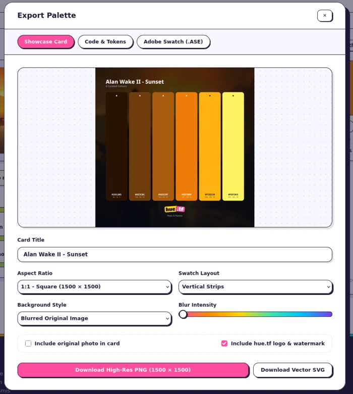

# Pixels To Palettes

> [Live site](https://hue.tf/) · [Codeberg](https://codeberg.org/aiquiral/hue.tf) · [Issues](https://codeberg.org/aiquiral/hue.tf/issues) · [Support](https://hue.tf/donate.html)

hue.tf is a small browser-based colour palette tool. It extracts colours from an image, lets you adjust them, and exports the result. Everything runs in the browser tab. Images are not uploaded, and there is no build step or server-side component.

*Pins mark where each colour came from. Drag them to re-sample, or click the image to add a colour.*

## What it does

| Feature | Details |
|---|---|
| **Extract** | Pulls a palette from WebP, AVIF, PNG, JPEG, or SVG images, depending on browser support. |
| **Refine** | Adjusts palette size, the sampling seed, and area averaging. |
| **Pins** | Draggable colour pins re-sample regions. Clicking the image adds a colour, and the screen eyedropper works where the browser supports it. |
| **Edit** | HEX, RGB, or HSL values, with controls to reorder, add, and delete swatches. |
| **Export** | PNG and SVG showcase cards, CSS, SCSS, Tailwind, JSON, HEX, HSL, and Adobe `.ASE` files. |
| **Share** | Puts a palette in the URL hash without the original image. |

## Export

*Showcase cards are generated locally, with selectable aspect ratios and swatch layouts.*

Showcase cards can be square, portrait, landscape, or story format. Swatches can be vertical strips, horizontal strips, or small squares. Strip layouts are disabled above 10 colours.

## Privacy

Images are decoded and sampled in the browser. Nothing is uploaded to a server. Share links encode only the palette in the URL fragment, so the palette is not sent in HTTP requests. A shared link does not include the original image.

## Troubleshooting

### Colours look random, the image shows stripes, or PNG export is blank

This usually means canvas pixel access is blocked. Privacy browsers and canvas blockers can block or fake canvas reads, which hue.tf needs for automatic extraction, pin sampling, the magnifier, and PNG export. If canvas access is allowed for the site, these features should work again. Manual HEX, RGB, or HSL editing, shared palettes, code and token exports, and `.ASE` files do not depend on canvas pixel reads. SVG export also remains available.

### Exporting is slow and the browser lags when making changes.

Some privacy browsers disable JavaScript JIT compilation. hue.tf performs extraction and canvas rendering in JavaScript, so the work becomes CPU heavy. Smaller palettes, no original photo in the card, a mesh or solid background, a smaller export ratio, and fewer open tabs all help. A browser or profile with JIT enabled will be faster if that trade-off is acceptable.

## Licence

The source code is licensed under the GNU Affero General Public License v3.0. See [LICENCE](LICENCE).

The hue.tf logo and favicon are released under [CC0 1.0](https://creativecommons.org/publicdomain/zero/1.0/). The wordmark uses slightly modified outlines from Titan One by Rodrigo Fuenzalida, licensed under the [SIL Open Font License 1.1](https://openfontlicense.org/).
